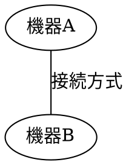

# 構成図管理フォルダ（diagrams）

このフォルダは、試験仕様書等に掲載する「構成図」（機器とその接続関係を示す図）を、絵を直接描くのではなく**データとして**管理するための仕組みです。

SVG・DOT・Graphvizについて知識がない方でも、このREADMEを読めば「仕組み」と「使い方」の両方が分かることを目標にしています。専門用語は、初めて出てきた箇所で説明します。

## 目次

1. [概要](#1-概要)
2. [SVGとは](#2-svgとは)
3. [DOTとGraphvizとは](#3-dotとgraphvizとは)
4. [フォルダ・ファイル構成](#4-フォルダファイル構成)
5. [新しい構成図の作成方法](#5-新しい構成図の作成方法)
6. [既存の構成図の修正方法](#6-既存の構成図の修正方法)
7. [共通スタイルの変更方法](#7-共通スタイルの変更方法)
8. [Markdownでの使用方法](#8-markdownでの使用方法)
9. [別のGitリポジトリへの流用方法](#9-別のgitリポジトリへの流用方法)
10. [注意事項](#10-注意事項)

---

## 1. 概要

このフォルダの目的は、試験仕様書等に載せる構成図（例：「iPadとiPhoneをBLEで接続する」といった、機器と接続関係を表す図）を、

- 誰が作っても同じ見た目（色・線・文字サイズ）になり、
- 機器が増えても手作業で位置を調整せずに済み、
- 図のテキストデータをGitで差分管理できる

ように、**完成画像（SVG）とその元データ（DOT）を分けて管理する**ことです。

基本方針は次のとおりです。

- 構成図の中身（どんな機器があり、どうつながっているか）は、`.dot`という名前のテキストファイルに書く。
- 色・線・文字サイズ等の見た目（デザイン）は、`diagram-style.json`という設定ファイルに1か所にまとめる。
- `.dot`ファイルと`diagram-style.json`から、`render.py`というプログラムを使って、画像ファイル（`.svg`）を自動的に作る。
- Markdown文書（試験仕様書等）からは、この`.svg`画像を参照する。

このフォルダは特定の案件（BlueCom）専用ではなく、他のプロジェクトにコピーしても使える汎用の仕組みとして作られています。

## 2. SVGとは

**SVG（Scalable Vector Graphics）**は、画像を描くためのファイル形式の1つです。拡張子は`.svg`です。

### PNGやJPEGとの違い

PNGやJPEGは「ピクセル（点）の集まり」として画像を保存します（ラスター画像と呼びます）。拡大すると輪郭がギザギザになったり、ぼやけたりします。

SVGは「図形を描く手順」をテキストで保存します（ベクター画像と呼びます）。例えば「ここに、幅100・高さ40の角丸四角形を描き、中に『iPad』という文字を書く」といった情報が、XMLというテキスト形式で記述されています。そのため、どれだけ拡大しても輪郭がギザギザになりません。

### SVGで表現できるもの

四角形・丸・線・曲線・文字・色・グラデーション等、図形としての表現はひととおり可能です。試験構成図のような「箱と線で機器のつながりを示す図」には適した形式です。

### SVGのメリット・デメリット

メリット：

- 拡大・縮小しても画質が劣化しない。
- ファイルサイズが比較的小さい（図形がシンプルな場合）。
- テキストエディタで中身を直接見ることができる（XML形式のテキストファイルのため）。
- GitHub上でそのままプレビュー表示できる。

デメリット：

- 写真のような複雑な濃淡を持つ画像には向かない（その場合はPNG等の方が適する）。
- 中身を直接編集するには、XMLやSVGの座標の知識が必要になる。

### SVGを直接編集できること

SVGはテキストファイルなので、テキストエディタで開いて文字や色を直接書き換えることも可能です。Illustrator等の画像編集ソフトで開いて見た目を調整することもできます。

### 今回はなぜDOTを編集元とするのか

SVGを直接編集すると、以下のような問題が起きやすくなります。

- 座標を自分で計算・調整する必要があり、機器が増えるたびに配置をやり直すことになる。
- 同じプロジェクト内でも、人によって色や線の太さがバラバラになりやすい。
- 「この図形がどの機器を表しているか」をSVGの座標情報から読み取るのは難しく、Gitの差分（変更箇所）も分かりにくい。

そこでこの仕組みでは、**SVGを直接編集するのではなく、DOTという「機器と接続関係だけを書いたシンプルなテキスト」を編集し、そこから自動的にSVGを生成する**方式を採っています。SVGは「DOTから自動的に作られる完成品」という位置づけです。

## 3. DOTとGraphvizとは

### DOTとは何か

**DOT**は、「どんな図形（ノード）があり、どれとどれがつながっているか（エッジ）」を記述するための、シンプルなテキスト形式（言語）です。拡張子は`.dot`です。

例えば、「機器Aと機器Bがあり、その2つがつながっている」という図は、DOTでは次のように書けます。



DOTファイルには、色や座標といった見た目の情報は（このフォルダの運用では）書きません。「何があって、何とつながっているか」という構成の情報だけを書きます。

### Graphvizとは何か

**Graphviz**は、DOT形式のファイルを読み込み、画像（SVG・PNG等）に変換するためのソフトウェアです。`dot`という名前のコマンド（プログラム）が含まれています。

### DOTからSVGを生成する仕組み

1. `.dot`ファイルに、機器（ノード）と接続（エッジ）を書く。
2. Graphvizの`dot`コマンドが、そのファイルを読み込む。
3. Graphvizが、図形の大きさ・配置・線の引き方を自動的に計算する（これを「自動レイアウト」と呼ぶ）。
4. 計算結果をもとに、SVGファイルを書き出す。

このフォルダでは、手順2〜4を`render.py`というPythonスクリプトが代行し、あわせて`diagram-style.json`に書かれた色や線のスタイルも適用します。

### 自動レイアウトの意味

「自動レイアウト」とは、図形をどこに・どんな大きさで配置するかを、人が座標で指定するのではなく、Graphvizが機器の数や文字の長さから自動的に計算する仕組みです。

このため、機器を1つ追加しても、既存の機器の位置を手作業で調整し直す必要は、基本的にありません（文字数が極端に長い、機器の数が非常に多い等の場合は、見やすさのために図を分けることを検討してください。[10. 注意事項](#10-注意事項)を参照）。

### DOTとSVGの役割の違い

| ファイル | 役割 | 人が編集するか |
|---|---|---|
| `.dot` | 構成図の「元データ」（何があって、何とつながっているか） | 編集する（ここが唯一の編集対象） |
| `.svg` | `.dot`とスタイル設定から自動生成された「完成画像」 | 原則編集しない（再生成で上書きされる） |

## 4. フォルダ・ファイル構成

```
docs/Test specification/
├── BlueCom設計検査仕様書.md         … このフォルダのSVGを参照する試験仕様書
└── diagrams/                         … 構成図管理フォルダ（このフォルダ）
    ├── README.md                     … このファイル
    ├── diagram-style.json            … 共通デザイン設定（全図で共通）
    ├── render.py                     … DOT→SVG変換スクリプト（全図で共通）
    ├── templates/
    │   └── basic-connection.dot      … 新しい図を作るときに複製するテンプレート
    ├── BlueCom試験構成図.dot         … BlueCom試験構成図の元データ（図ごとの専用ファイル）
    └── BlueCom試験構成図.svg         … BlueCom試験構成図の完成画像（図ごとの専用ファイル）
```

**共通ファイル**（すべての図に関わる、1つしかないファイル）：

- `diagram-style.json`：すべての図に共通する色・線・文字サイズ等の設定。
- `render.py`：どの`.dot`ファイルに対しても使える変換プログラム。
- `templates/basic-connection.dot`：新しい図のひな形。

**図ごとの専用ファイル**（図1つにつき1組作られる）：

- `BlueCom試験構成図.dot`と`BlueCom試験構成図.svg`が1組。
- 今後、別の構成図を追加する場合は、同じように「図の名前.dot」と「図の名前.svg」の組が増えていきます。

図ごとの専用ファイルには、日本語ファイル名を使用できます（[10. 注意事項](#10-注意事項)の日本語ファイル名に関する項目も参照してください）。

## 5. 新しい構成図の作成方法

ここでは例として、「PLCとPCをEthernetで接続する構成図」を新しく作る場合の手順を説明します。

**この例はあくまで手順の説明用です。実際にPLC構成図のファイルは作成していません。** 同じ手順で、実際に必要な図を作成してください。

### 手順

1. テンプレートをコピーする。

   ```bash
   cd "docs/Test specification/diagrams"
   cp templates/basic-connection.dot "PLC構成図.dot"
   ```

2. コピーした`.dot`ファイルをテキストエディタで開き、機器名と接続を書き換える。

   テンプレートの中身（`templates/basic-connection.dot`）は次のようになっています。

   ```dot
   graph 構成図テンプレート {
       rankdir=LR;

       機器A [label="機器A"];
       機器B [label="機器B"];

       機器A -- 機器B [label="接続方式"];
   }
   ```

   これを、例えば次のように書き換えます。

   ```dot
   graph PLC構成図 {
       rankdir=LR;

       PC [label="PC（1台）"];
       PLC [label="PLC（1台）"];

       PC -- PLC [label="Ethernet"];
   }
   ```

   - `[label="..."]`の中身が、図に表示される名前になります。
   - `機器A -- 機器B`の部分が、接続関係を表します。機器を増やす場合は、同じように行を追加します（例：`PLC -- サーバー [label="RS-485"];`）。
   - 色・枠線・文字サイズ等は書き換える必要はありません（`diagram-style.json`で一括管理されます）。

3. SVGを生成する。

   ```bash
   python3 render.py "PLC構成図.dot"
   ```

   同じ場所に`PLC構成図.svg`が生成されます。

4. 生成されたSVGを開いて、文字の欠け・重なり・線のつながりを確認する。

5. 必要に応じて、Markdown文書から新しいSVGを参照する（[8. Markdownでの使用方法](#8-markdownでの使用方法)を参照）。

## 6. 既存の構成図の修正方法

対象の`.dot`ファイルをテキストエディタで開き、以下のように編集した後、必ず`render.py`で再生成してください。

### 機器の追加

既存の機器定義行をまねて、新しい行を追加します。

```dot
サーバー [label="サーバー（1台）"];
```

### 機器の削除

対象の機器定義行（`機器名 [label="..."];`）と、その機器が関わる接続行（`機器名 -- 他の機器名 [...]`）の両方を削除します。接続行だけ消し忘れると、存在しない機器を参照してGraphvizがエラーになります。

### 機器名の変更

機器定義行の`label="..."`の中身を書き換えます。

```dot
iPad [label="iPad（2台）"];
```

機器のID（`iPad`の部分）はGraphviz内部の識別名であり、図に表示される文字ではありません。表示名だけを変えたい場合は`label`の中身のみを変更し、IDは変更しないことをおすすめします（IDを変更する場合は、その機器が関わる接続行のID表記もあわせて変更してください）。

### 接続の追加・削除

接続を追加する場合は、`機器A -- 機器B [label="接続方式"];`の形式で行を追加します。削除する場合は該当行を削除します。

### 通信方式の変更

接続行の`label="..."`の中身（例：`"BLE通信"`、`"Ethernet"`）を書き換えます。

### SVGの再生成

`.dot`ファイルを編集したら、対応する`.svg`を必ず再生成してください。

```bash
python3 render.py "対象のファイル名.dot"
```

再生成を忘れると、`.dot`（最新の内容）と`.svg`（古い画像のまま）が食い違った状態になります。

## 7. 共通スタイルの変更方法

色や線等の共通デザインは、すべて`diagram-style.json`にまとまっています。このファイルを編集すると、**このフォルダ内のすべての図**の見た目が一括で変わります。

```json
{
  "font": "IPAGothic",
  "fontSize": 14,
  "fontColor": "#1a3d7c",
  "fillColor": "#eaf3fb",
  "strokeColor": "#1a3d7c",
  "strokeWidth": 1.5,
  "cornerRounded": true,
  "edgeColor": "#1a3d7c",
  "edgeWidth": 1.2,
  "nodeSpacing": 0.6
}
```

| 設定項目 | 意味 |
|---|---|
| `font` | フォント（文字の書体）名。OS・Graphvizが認識できるフォント名を指定する。 |
| `fontSize` | 文字サイズ（ポイント単位）。 |
| `fontColor` | 文字色。`#RRGGBB`形式の16進数カラーコードで指定する。 |
| `fillColor` | 図形（機器を表す箱）の背景色。 |
| `strokeColor` | 図形の枠線の色。 |
| `strokeWidth` | 図形の枠線の太さ。 |
| `cornerRounded` | 図形の角を丸めるかどうか（`true`／`false`）。Graphvizには角丸の半径を数値で指定する機能が無いため、丸めるかどうかの設定のみとしている（詳細は[10. 注意事項](#10-注意事項)）。 |
| `edgeColor` | 接続線の色。 |
| `edgeWidth` | 接続線の太さ。 |
| `nodeSpacing` | 図形間の間隔。機器同士の横方向・縦方向の余白に、同じ値を適用する。 |

**スタイルを変更した後は、既存のすべての`.svg`を再生成する必要があります。** 自動的には更新されません。

```bash
# このフォルダ内のすべての.dotファイルを再生成する例
python3 render.py *.dot templates/*.dot
```

複数ファイルをまとめて再生成する場合、`-o`（出力先を1つに指定するオプション）は使用できません。各`.dot`ファイルと同じ場所に、同じ名前の`.svg`が自動的に生成されます。

## 8. Markdownでの使用方法

生成したSVGは、Markdown文書から画像として参照できます。試験仕様書（`docs/Test specification/BlueCom設計検査仕様書.md`）からの参照例は次のとおりです。

```markdown

```

- ``がMarkdownの画像表示の書き方です。
- パスは、参照元のMarkdownファイルから見た相対パスで指定します。試験仕様書（`docs/Test specification/BlueCom設計検査仕様書.md`）から見ると、このフォルダは`./diagrams/`になります。

### GitHubでのプレビュー方法

GitHub上でMarkdownファイルを開く（またはPull Requestの差分を見る）と、上記の記法で参照されたSVGファイルは自動的に画像として表示されます。特別な設定は不要です。

SVGファイル自体のリンクをGitHub上で直接開いた場合も、ブラウザ上で画像として表示されます。

## 9. 別のGitリポジトリへの流用方法

この`diagrams`フォルダは、他のプロジェクト（別のGitリポジトリ）にそのままコピーして使うことができます。目的によって、やることが異なります。

### 同じ図を表示するだけの場合

コピー先のMarkdownから、[8. Markdownでの使用方法](#8-markdownでの使用方法)と同じ書き方で`.svg`ファイルを参照するだけで構いません。`.dot`ファイルやPythonは不要です。

### 既存の図を改変する場合

`diagrams`フォルダ一式（`README.md`・`diagram-style.json`・`render.py`・`templates/`・対象の`.dot`／`.svg`）をコピーし、[6. 既存の構成図の修正方法](#6-既存の構成図の修正方法)の手順で`.dot`を編集し、再生成してください。

### 同じスタイルで新しい図を作成する場合

`diagrams`フォルダ一式をコピーし、[5. 新しい構成図の作成方法](#5-新しい構成図の作成方法)の手順で`templates/basic-connection.dot`を複製して新しい図を作成してください。`diagram-style.json`と`render.py`は手を加えずにそのまま使えます。

### 注意：コピー後は自動的に同期されない

`diagrams`フォルダを別リポジトリへコピーした場合、コピー元とコピー先はその時点で別々のファイルになります。片方を更新しても、もう片方には反映されません（Gitの通常のコピー＆別管理と同じです）。両方を同じ内容に保ちたい場合は、変更のたびに手動でコピーし直すか、共通化する方法（例：共有リポジトリ化）を別途検討してください。

## 10. 注意事項

- **SVGを直接編集した場合、再生成で変更が失われます。** `.svg`は`.dot`から自動生成される完成品として扱ってください。見た目を直したい場合は、`.dot`または`diagram-style.json`を編集してから再生成してください。
- **日本語ファイル名を使用する際の注意**：このフォルダのファイル・フォルダ名はUTF-8のファイル名として扱われます。Windows環境等、一部の環境・ツールでは日本語ファイル名の扱いに制限がある場合があります。コマンドラインで日本語ファイル名を扱う際は、本READMEの例のように、ファイル名を引用符（`"..."`）で囲んでください。
- **GraphvizとPythonが必要です。** `render.py`の実行には、Python 3とGraphviz（`dot`コマンド）の両方がインストールされている必要があります。Graphvizが見つからない場合、`render.py`はインストール方法を含むエラーメッセージを表示します。
- **Graphvizのバージョンやフォント環境によって見た目が変わる可能性があります。** 同じ`.dot`ファイルでも、Graphvizのバージョンや、実行環境にインストールされているフォントが異なると、文字の幅・図形の大きさ・改行位置等がわずかに変わることがあります。このフォルダは`diagram-style.json`の`font`に`IPAGothic`（日本語フォントの1つ）を指定しています。生成環境にこのフォントが無い場合は、別の日本語フォント名に変更するか、インストールしてください。
- **GitHubとWord・PDF変換での表示互換性**：SVGはGitHub上のMarkdownプレビューで問題なく表示されます。MarkdownをWordやPDFへ変換するツールを使用する場合、ツールによってはSVGの埋め込みに対応していないことがあります。その場合は、変換前にSVGをPNG等へ変換する（例：`dot -Tpng`での生成、または変換ツール側の設定）等の対応が必要になる場合があります。
- **図が複雑になった場合の可読性と分割の考え方**：機器や接続が増えすぎると、自動レイアウトでも図が見づらくなることがあります。目安として、1つの図に含める機器は「ひと目で全体の構成が把握できる数」にとどめ、関心事が大きく異なる構成（例：試験環境全体のネットワーク構成と、個別機器内部の接続構成）は、`.dot`ファイルを分けて複数の図にすることを検討してください。
- **角丸の半径について**：`diagram-style.json`の`cornerRounded`は、角を丸めるかどうかの有無のみを設定します。Graphvizの図形（box）には、角丸の半径をポイント数等で細かく指定する標準機能が無いため、丸める場合の丸み具合はGraphvizが自動的に決定します。
