# BlueCom UI設計書

## 変更履歴

## 目次

1. [概要](#1-概要)
2. [画面オプション](#2-画面オプション)
3. [画面構成・画面遷移](#3-画面構成画面遷移)
4. [共通表示・操作仕様](#4-共通表示操作仕様)
5. [TOP画面](#5-top画面)
6. [Bluetooth接続画面](#6-bluetooth接続画面)
7. [データ送信画面](#7-データ送信画面)
8. [データ受信画面](#8-データ受信画面)
9. [共通の異常・中断時の画面動作](#9-共通の異常中断時の画面動作)

## 1. 概要

本書は、BLEデータ通信アプリケーション「BlueCom」のユーザーインターフェース仕様を定義する。画面構成、画面レイアウト、操作に対する表示・画面遷移、および異常・中断時の画面動作を記載する。

参考文書：[要件定義書.md](./要件定義書.md)

## 2. 画面オプション

| 項目 | 対応 |
|---|---|
| 画面の向き | 縦画面固定 |
| 画面レイアウト | iPhone・iPad共通 |
| 配色 | ライトモード固定 |
| 文字サイズ | 固定 |

## 3. 画面構成・画面遷移

### 3.1 画面一覧

| 画面名 | 用途 |
|---|---|
| TOP画面 | アプリ起動時に表示 |
| Bluetooth接続画面 | IDを指定し、通信相手とのBluetooth接続を確立 |
| データ送信画面 | データを選択して送信 |
| データ受信画面 | データを受信し、受信内容を表示 |

### 3.2 画面遷移

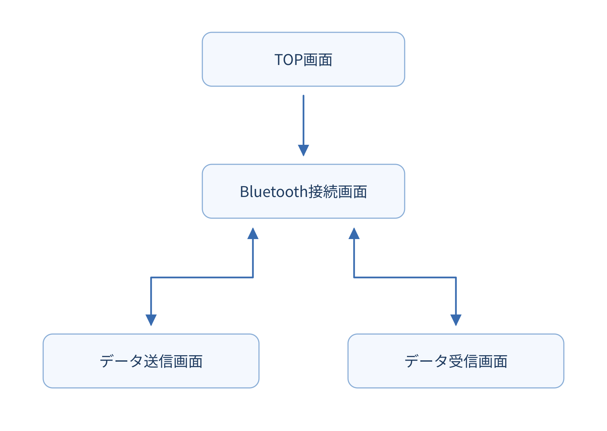

| 遷移元 | 操作・条件 | 遷移先 |
|---|---|---|
| TOP画面 | 表示から5秒経過 | Bluetooth接続画面 |
| Bluetooth接続画面 | 「接続開始」を押し、接続成功 | データ送信画面 |
| 同上 | 「待受開始」を押し、接続成功 | データ受信画面 |
| データ送信画面 | 「戻る」を押す | Bluetooth接続画面 |
| データ受信画面 | 「戻る」を押す | Bluetooth接続画面 |

## 4. 共通表示・操作仕様

| 項目 | 仕様 |
|---|---|
| ダイアログ表示中の操作 | 背面の画面を操作不可とする。 |
| 通知ダイアログ | OKボタンがある場合は、OKボタンを押すと閉じる。外側のタップや時間経過では閉じない。OKボタンがない場合は、閉じる条件とその後の動作を各画面の仕様に記載する。 |
| 処理中ダイアログ | 処理状況を示し、処理が完了すると閉じる。 |

## 5. TOP画面

### 5.1 画面レイアウト

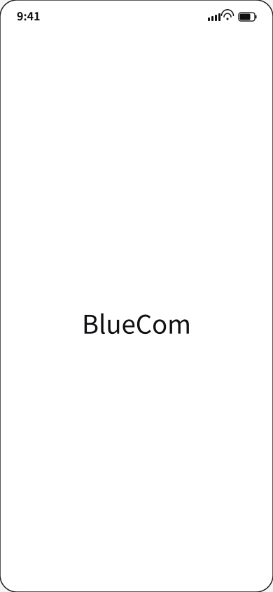

### 5.2 表示・動作

| 契機 | 表示・動作 |
|---|---|
| アプリ起動時 | 「BlueCom」を表示する。 |
| 表示から5秒経過 | Bluetooth接続画面へ遷移する。 |

## 6. Bluetooth接続画面

### 6.1 画面レイアウト

初期表示

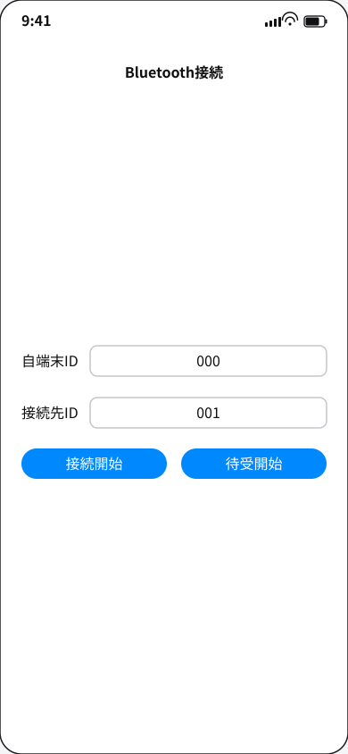

接続中（接続・待受共通）

接続成功

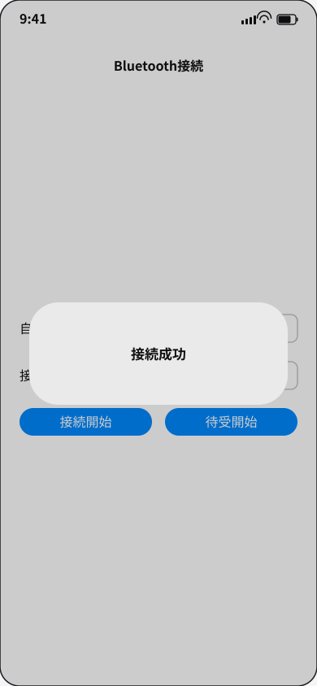

Bluetooth使用不許可

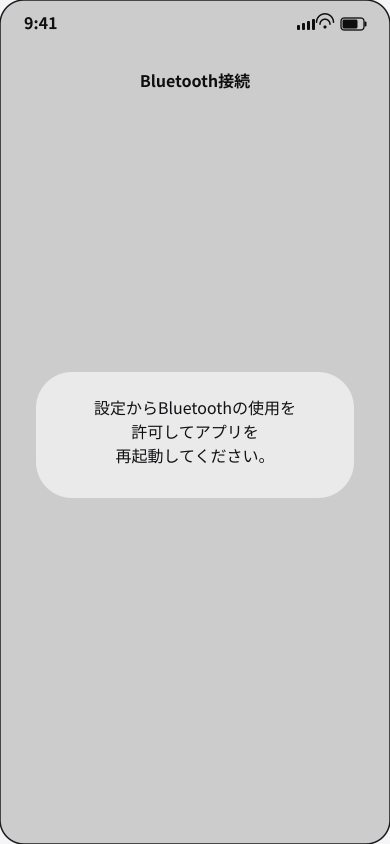

端末のBluetoothがOFF

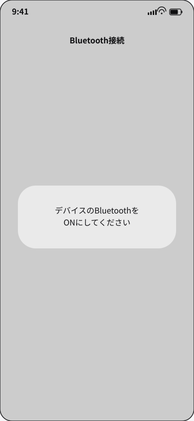

自端末IDと接続先IDが同じ場合

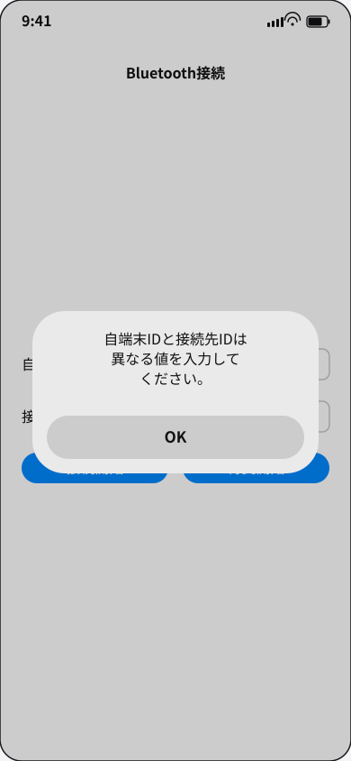

接続失敗（接続・待受共通）

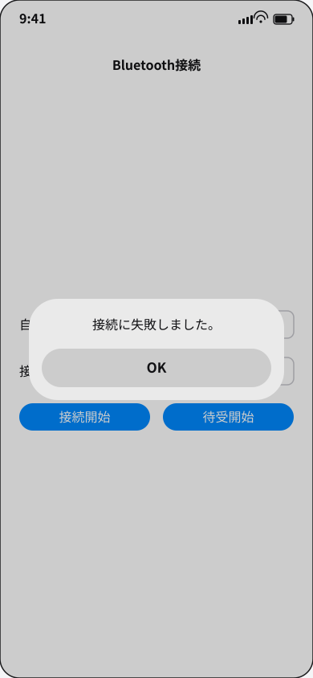

### 6.2 表示・入力項目

| 項目 | 初期値 | 入力条件 |
|---|---|---|
| 自端末ID | 000 | 半角数字、最大3桁 |
| 接続先ID | 001 | 半角数字、最大3桁 |

ID入力欄をタップすると、標準の数字入力用キーボードを表示する。完了ボタンは追加しない。

編集中は空欄を許可する。入力・貼り付けによって入力条件を満たさなくなる場合は、その操作による変更を受け付けない。

「接続開始」「待受開始」をタップしたとき、1〜2桁の入力値は先頭をゼロで埋めて3桁に補正し、空欄は「000」とする。

データ送信画面・データ受信画面から戻ったときは、直前に入力したIDを保持する。

### 6.3 表示・動作

| 契機 | 表示・動作 |
|---|---|
| Bluetooth接続画面を表示したとき | アプリで初めてBluetoothを使用するときは、OS標準の使用許可確認ダイアログを表示する。「許可」を選択すると、ID入力欄と「接続開始」「待受開始」ボタンを表示する。許可済みの場合は、ID入力欄と「接続開始」「待受開始」ボタンを表示する。 |
| 「接続開始」をタップし、接続処理を開始するとき | キーボードを閉じ、「接続中」のメッセージとインジケーターを表示する。 |
| 接続開始後、接続が成立したとき | 「接続中」ダイアログを閉じ、「接続成功」ダイアログを表示する。3秒後にダイアログを閉じ、データ送信画面へ遷移する。 |
| 「待受開始」をタップし、待受処理を開始するとき | キーボードを閉じ、「接続中」のメッセージとインジケーターを表示する。 |
| 待受開始後、接続が成立したとき | 「接続中」ダイアログを閉じ、「接続成功」ダイアログを表示する。3秒後にダイアログを閉じ、データ受信画面へ遷移する。 |

### 6.4 異常時の表示・動作

| 契機 | 表示・動作 |
|---|---|
| Bluetooth接続画面の表示時に、アプリのBluetooth使用が不許可の場合 | ID入力欄と「接続開始」「待受開始」ボタンを非表示にし、「アプリのBluetooth使用を許可してください。」をOKボタンなしで固定表示する。 |
| Bluetooth接続画面の表示時に、端末のBluetoothがOFFの場合 | ID入力欄と「接続開始」「待受開始」ボタンを非表示にし、「デバイスのBluetoothをONにしてください」をOKボタンなしで固定表示する。 |
| 「接続開始」「待受開始」をタップし、自端末IDと接続先IDが同じ場合 | 通信を開始せず、「自端末IDと接続先IDは異なる値を入力してください。」の通知ダイアログを表示する。OKを押すと通知を閉じ、入力値を保持したBluetooth接続画面で修正できる。 |
| 接続開始または待受開始に失敗したとき | 「接続中」ダイアログを閉じ、「接続に失敗しました。」の通知ダイアログを表示する。OKを押すと通知を閉じ、入力値を保持したBluetooth接続画面で再操作できる。 |

使用不許可・Bluetooth OFFの通知は、アプリのBluetooth使用が許可され、端末のBluetoothがONになったら閉じ、ID入力欄と「接続開始」「待受開始」ボタンを表示する。利用者によるアプリの再起動は不要とする。

## 7. データ送信画面

### 7.1 画面レイアウト

初期表示

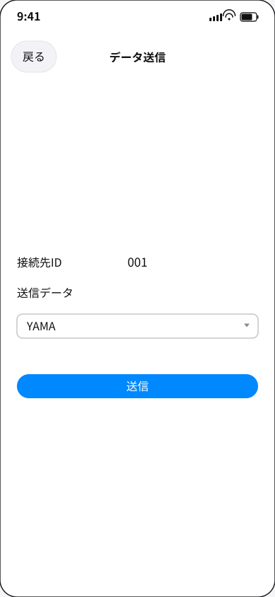

送信データの選択肢を表示中

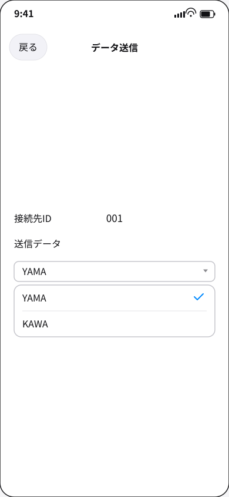

データ送信中

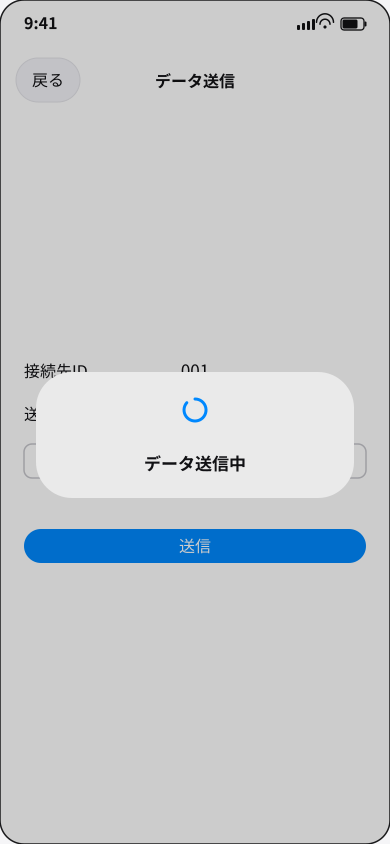

データ送信完了

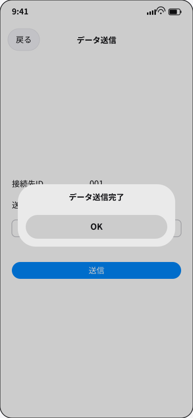

データ送信失敗

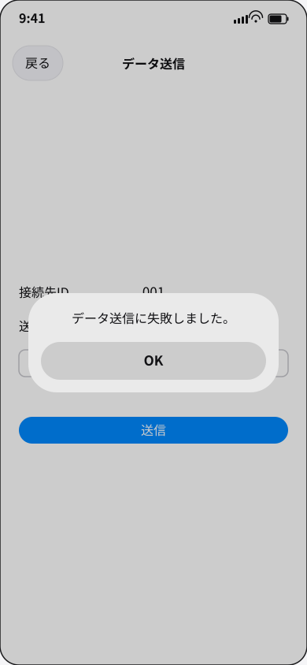

### 7.2 表示・入力項目

| 項目 | 表示・操作 |
|---|---|
| 接続先ID | 接続時に指定した接続先IDを表示する。編集はできない。 |
| 送信データ | データ送信画面に入ったときは「YAMA」を選択済みとする。選択欄をタップすると、その直下に「YAMA」「KAWA」を縦に表示し、現在の選択肢にチェックを付ける。項目を選択すると一覧を閉じ、選んだ値を選択欄に表示する。 |

### 7.3 表示・動作

| 契機 | 表示・動作 |
|---|---|
| 「送信」をタップしたとき | 選択したデータの送信を開始し、「データ送信中」のメッセージとインジケーターを表示する。 |
| 送信が成功したとき | 「データ送信中」を閉じ、「データ送信完了」を表示する。OKを押すと通知を閉じ、選択したデータを保持したままデータ送信画面で再操作できる。 |
| 「戻る」をタップしたとき | Bluetooth通信を切断し、Bluetooth接続画面へ戻る。 |

### 7.4 異常時の表示・動作

| 契機 | 表示・動作 |
|---|---|
| データ送信に失敗したとき | Bluetooth接続を切断し、「データ送信中」を閉じて「データ送信に失敗しました。」を表示する。OKを押すと通知を閉じ、Bluetooth接続画面へ戻る。 |

## 8. データ受信画面

### 8.1 画面レイアウト

画面遷移直後の受信中

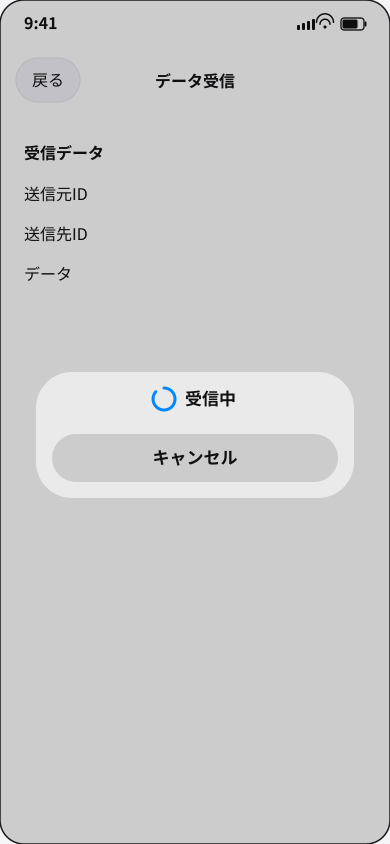

初回受信をキャンセルした後

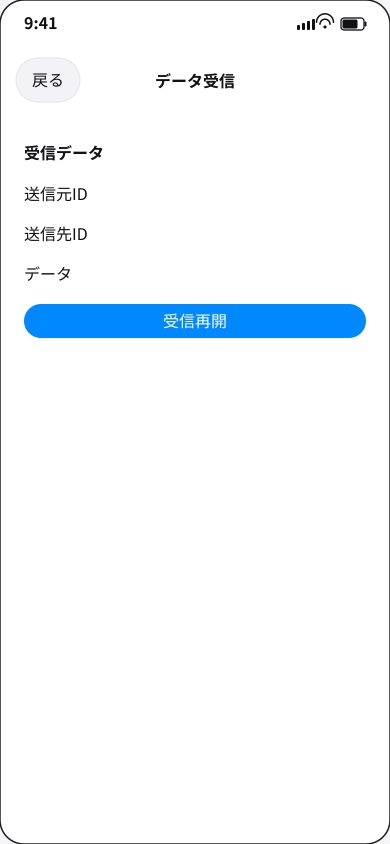

受信再開後の受信中

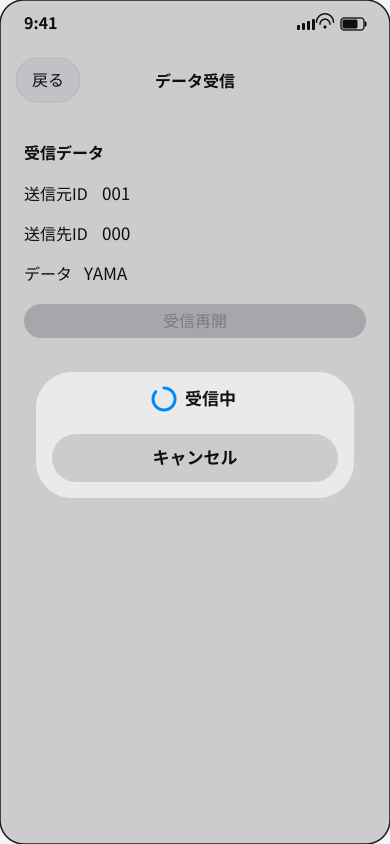

受信完了通知を表示中

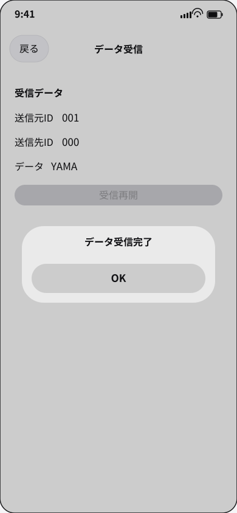

受信完了通知を閉じた後

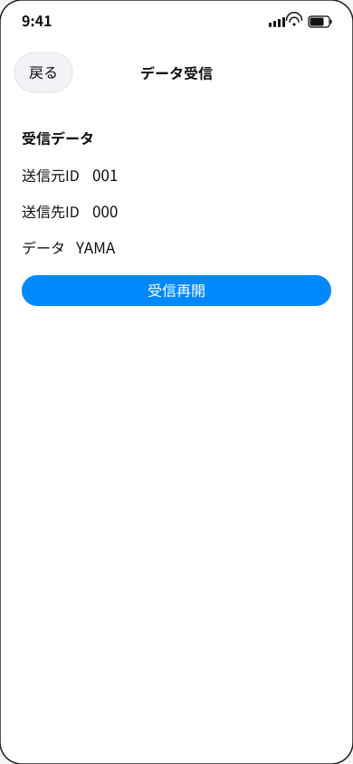

不正データ通知（初回受信中）

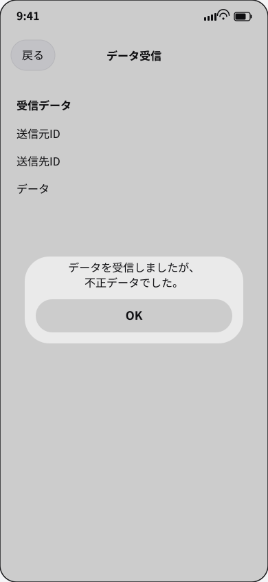

不正データ通知（受信再開後）

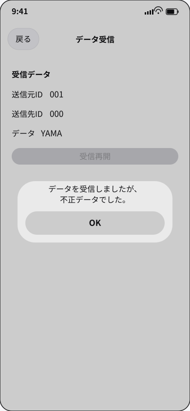

### 8.2 表示・入力項目

| 項目 | 表示・操作 |
|---|---|
| 送信元ID、送信先ID、データ | 正常に受信した内容を表示する。初回の正常受信までは空欄とする。 |
| 受信再開 | 画面遷移直後は表示しない。正常受信後、または受信をキャンセルした後に表示する。ダイアログ表示中は、背面に表示されている場合も操作できない。 |

### 8.3 表示・動作

| 契機 | 表示・動作 |
|---|---|
| データ受信画面に遷移したとき | 受信を開始し、インジケーターと「キャンセル」ボタン付きの「受信中」ダイアログを表示する。 |
| 「受信再開」をタップしたとき | 受信を開始し、画面遷移直後と同じ「受信中」ダイアログを表示する。背面の受信結果と「受信再開」ボタンは表示したままとする。 |
| 「キャンセル」をタップしたとき | 今回の受信を中断してダイアログを閉じる。Bluetooth接続を維持し、受信結果の表示を保持したまま「受信再開」を操作できる状態にする。初回受信をキャンセルした場合は、受信結果を空欄のままとする。 |
| データを正常に受信したとき | 受信結果を今回の内容に更新し、「受信中」ダイアログを閉じて「データ受信完了」を表示する。OKを押すと通知を閉じ、「受信再開」を操作できる状態にする。 |
| 「戻る」をタップしたとき | 受信を終了してBluetooth通信を切断し、Bluetooth接続画面へ戻る。 |

### 8.4 異常時の表示・動作

| 契機 | 表示・動作 |
|---|---|
| 不正データを受信したとき | 「受信中」ダイアログを閉じ、「データを受信しましたが、不正データでした。」とOKボタンを表示する。背面の表示とBluetooth接続を維持する。OKを押すと通知を閉じ、キャンセル付きの「受信中」ダイアログに戻って受信を継続する。 |

## 9. 共通の異常・中断時の画面動作
