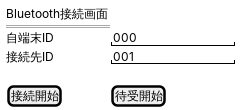
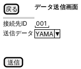
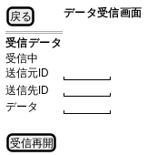

# 要件定義書

## 表紙

| 項目 | 内容 |
|---|---|
| ドキュメントタイトル | 要件定義書 |
| 対象アプリケーション | BlueCom |
| 版数 | 0.2 |
| 作成日 | |
| 作成者 | |
| 承認者 | |

## 変更履歴

| 版数 | 日付 | 内容 | 作成者 |
|---|---|---|---|
| 0.1 | | 初版作成（第1章「概要」のみ確定、第2章〜第6章は見出しのみ） | |
| 0.2 | 2026-10-25 | 第2章〜第5章を確定内容で記載し、画面図を追加。第6章「制約事項」を削除 | |

## 目次

1. [概要](#1-概要)
2. [動作環境](#2-動作環境)
3. [システム構成](#3-システム構成)
4. [機能要件](#4-機能要件)
5. [通信要件](#5-通信要件)

## 1. 概要

BlueComは、iPadおよびiPhoneに同一のアプリをインストールし、Bluetooth Low Energy（BLE）を使用して2台の端末間でデータを送受信する検証用アプリである。

一方の端末を接続側（Central）、もう一方を待受側（Peripheral）として動作させ、通信の成立およびデータ送受信の結果を画面上で確認できることを目的とする。

## 2. 動作環境

| 項目 | 内容 |
|---|---|
| 対応OS | iOS 27 |

## 3. システム構成

- BlueComをインストールした2台の端末で構成する。
- BLEによる1対1の直接通信とする。
- 同一アプリがCentralとPeripheralの両方に対応する。
- 一方をCentral、他方をPeripheralとして使用する。
- 役割は「接続開始」「待受開始」の操作によって決まる。

## 4. 機能要件

### 4.1 画面構成

BlueComは、以下の4画面で構成する。

| No | 画面名 |
|---|---|
| 1 | TOP画面 |
| 2 | Bluetooth接続画面 |
| 3 | データ送信画面 |
| 4 | データ受信画面 |

### 4.2 TOP画面

#### 画面レイアウト

#### 機能

- 起動時に表示する。
- 表示から5秒後にBluetooth接続画面へ自動遷移する。
- TOP画面へ戻る操作はできない。

### 4.3 Bluetooth接続画面

#### 画面レイアウト

#### 機能

- 自端末IDと接続先IDを入力する。
- IDは3桁の数値文字列とし、範囲は000〜999とする。
- 初期値は自端末ID「000」、接続先ID「001」とする。
- 自端末IDと接続先IDが一致する場合は通信を開始しない。
- Bluetooth使用が許可されていない場合は、接続操作および他画面への遷移を許可しない。
- 「接続開始」で相手へ接続し、成立後はデータ送信画面へ遷移する。
- 「待受開始」で相手からの接続を待ち、成立後はデータ受信画面へ遷移する。

### 4.4 データ送信画面

#### 画面レイアウト

#### 機能

- 接続先IDを表示する。
- 送信データとしてYAMAまたはKAWAを選択する。
- 「送信」で選択したデータを送信し、結果を表示する。
- 「戻る」で通信を切断し、Bluetooth接続画面へ戻る。

### 4.5 データ受信画面

#### 画面レイアウト

#### 機能

- 画面遷移直後に受信を開始し、「受信中」ダイアログを表示する。
- 正常受信時は「受信中」ダイアログを閉じ、「データ受信完了」を表示する。受信した送信元ID・送信先ID・データを表示する。
- 受信後は「受信再開」を表示する。
- 「受信再開」で次の受信を開始する。
- 「戻る」で受信を終了して通信を切断し、Bluetooth接続画面へ戻る。
- 不正データ時は「データを受信しましたが、不正データでした。」を表示する。OK操作または5秒経過後に「受信中」へ戻り、受信を継続する。

## 5. 通信要件

### 5.1 通信データ形式

通信データは固定18byteとし、次の構成とする。

| 項目 | サイズ | 内容 |
|---|---|---|
| 送信種別 | 1byte | 要求0x29、応答0x92 |
| 通信種別 | 1byte | 通信開始・待受0x01、データ送受信0x02 |
| 送信元ID | 3byte | 送信元の端末ID |
| 送信先ID | 3byte | 送信先の端末ID |
| 入力データ | 10byte | 送受信するデータ |

IDは000〜999の数値文字列をASCII変換する。入力データの未使用領域は0x20で埋める。

### 5.2 Bluetooth通信開始

- 「接続開始」側をCentralとする。
- 相手へ接続後、通信開始要求を1回送信し、応答を待つ。
- 要求は送信種別0x29、通信種別0x01、送信元IDは自端末ID、送信先IDは接続先ID、入力データは全10byteを0x20とする。
- 応答は送信種別0x92、通信種別0x01、送信元IDは接続先ID、送信先IDは自端末ID、入力データは全10byteを0x20とする。
- 「接続開始」押下から60秒以内に成立しなければ失敗とする。
- 成立後はデータ送信画面へ遷移する。

### 5.3 Bluetooth通信待受

- 「待受開始」側をPeripheralとする。
- 接続先IDの端末から通信開始要求を待ち、正常な要求に対して応答を1回送信する。
- 要求・応答は5.2と整合する形式とする。
- 「待受開始」押下から60秒以内に成立しなければ失敗とする。
- 成立後はデータ受信画面へ遷移する。

### 5.4 データ送信

- 選択したYAMAまたはKAWAをASCII変換し、入力データの残りを0x20で埋め、1回送信する。
- 要求は送信種別0x29、通信種別0x02、送信元IDは自端末ID、送信先IDは接続先IDとする。
- 正常応答は送信種別0x92、通信種別0x02、送信元IDは接続先ID、送信先IDは自端末ID、入力データは全10byteを0x20とする。
- 10秒以内の正常応答で成功とする。
- 正常応答を受信できなければ失敗とし、Bluetooth接続を切断する。
- 送信結果を画面へ通知する。

### 5.5 データ受信

- データ受信画面への遷移直後、または「受信再開」押下時に開始する。
- データ長18byte、送信種別0x29、通信種別0x02、送信元ID＝接続先ID、送信先ID＝自端末ID、入力データ＝ASCIIのYAMAまたはKAWAと残部0x20を正常条件とする。
- 正常時は、送信元端末へ応答を1回送信し、受信データを画面へ通知する。
- 応答は送信種別0x92、通信種別0x02、送信元IDは自端末ID、送信先IDは接続先ID、入力データは全10byteを0x20とする。
- 不正データ時は応答を送信せず、Bluetooth接続を維持する。

### 5.6 Bluetooth通信切断

#### 5.6.1 切断条件

次の条件に該当する場合、Bluetooth通信を切断する。

| No | 切断条件 |
|---|---|
| 1 | Bluetooth通信開始または待受開始に失敗した場合 |
| 2 | データ送信に失敗した場合 |
| 3 | データ送信画面で「戻る」を押した場合 |
| 4 | データ受信画面で「戻る」を押した場合 |
| 5 | 通信中に予期しない切断が発生した場合 |

No.5の例として、次の事象が挙げられる。

1. 自端末のアプリをバックグラウンドへ移行する
2. 自端末のアプリを強制終了する
3. 自端末をロックする
4. Bluetooth通信圏外

上記1〜3の事象が発生した場合は、通信を切断し、切断通知をしてBluetooth接続画面に戻る。

上記4の場合は、切断を検出したら、切断通知をしてBluetooth接続画面に戻る。

#### 5.6.2 切断処理

切断時は、次の処理を行う。

1. 通信処理を終了する。
2. Bluetooth接続を切断する。
3. 通信状態を初期化し、未接続状態にする。
